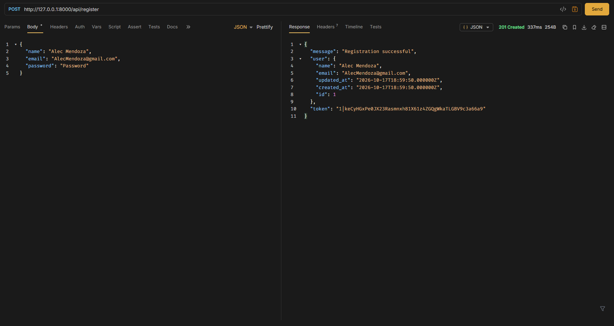
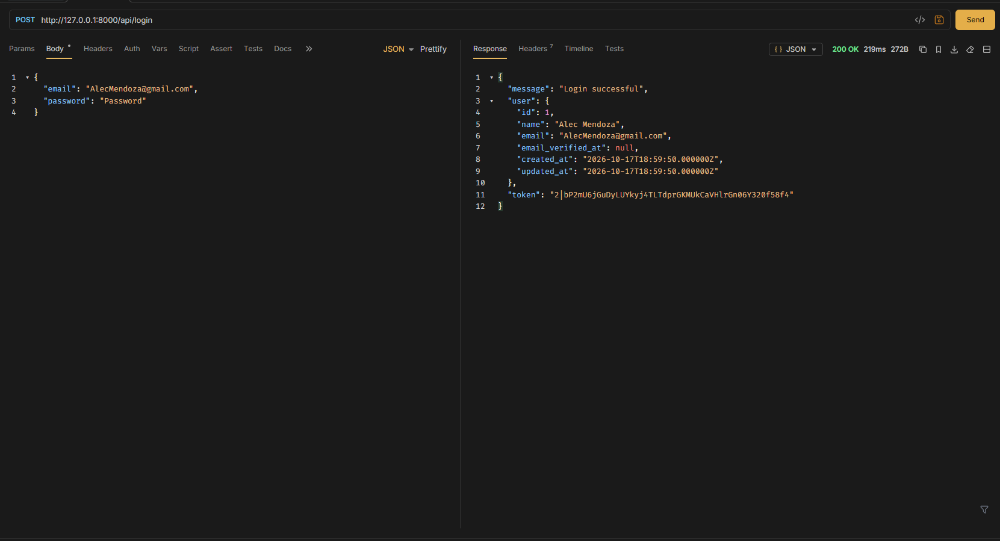
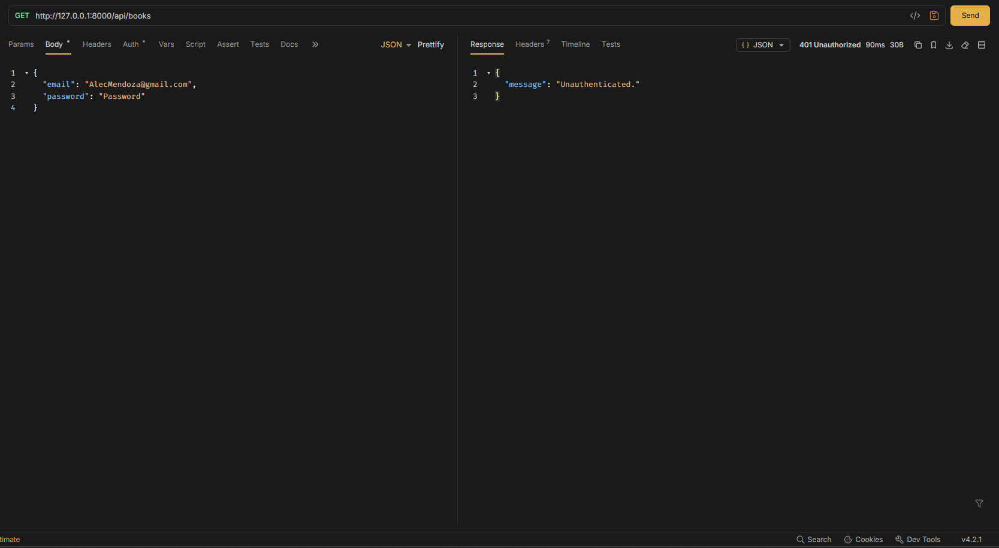
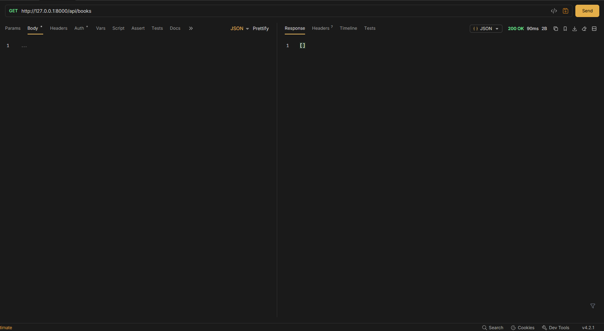
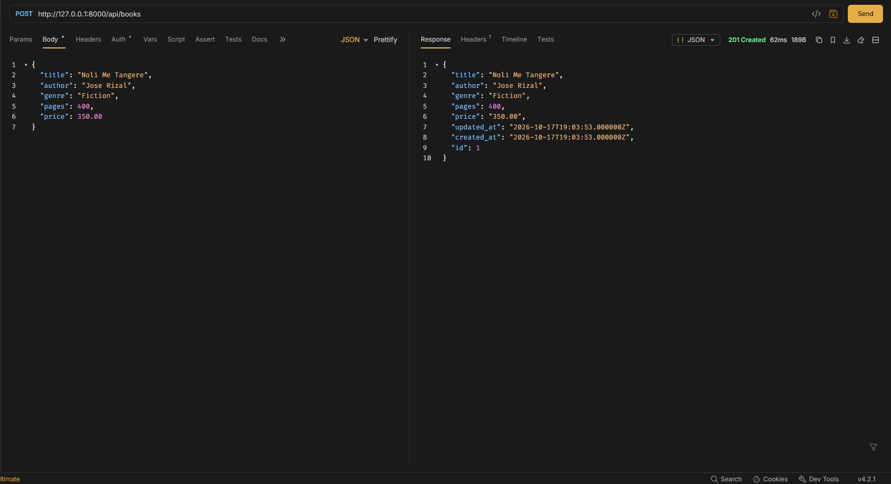
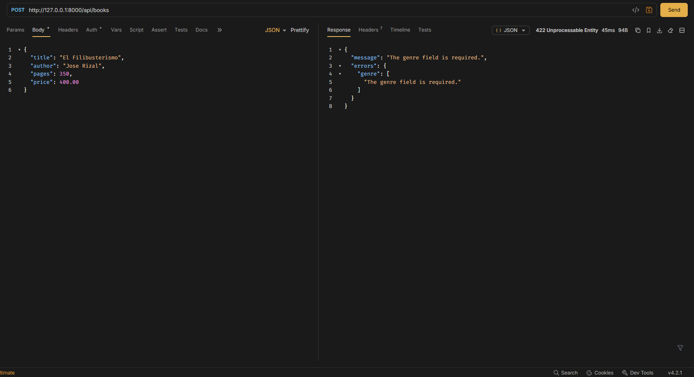
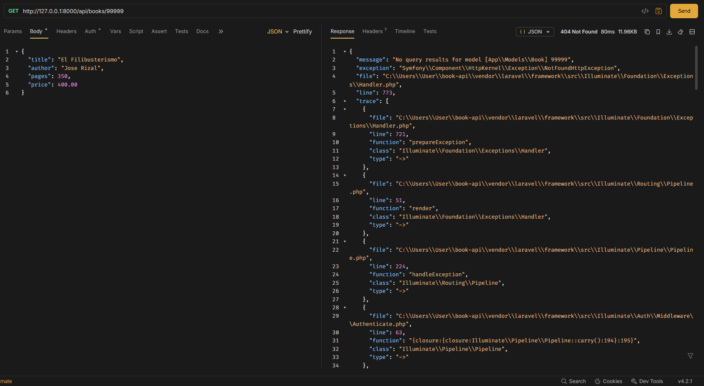
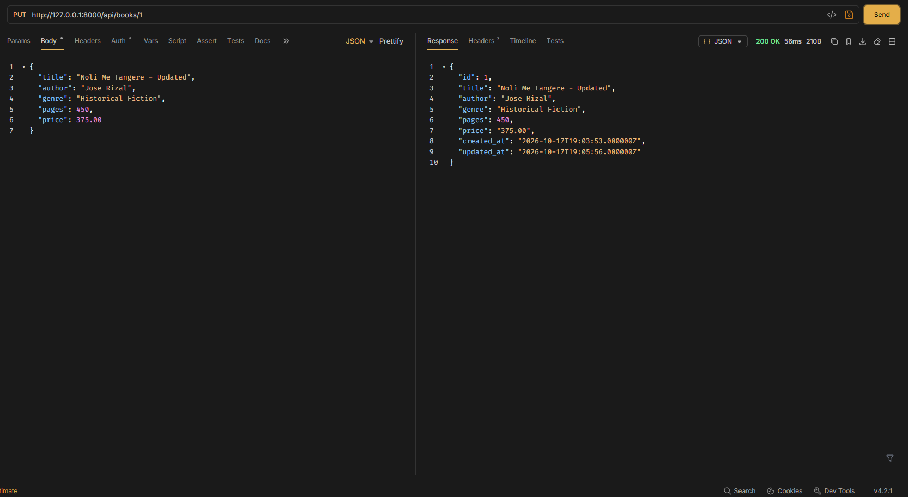
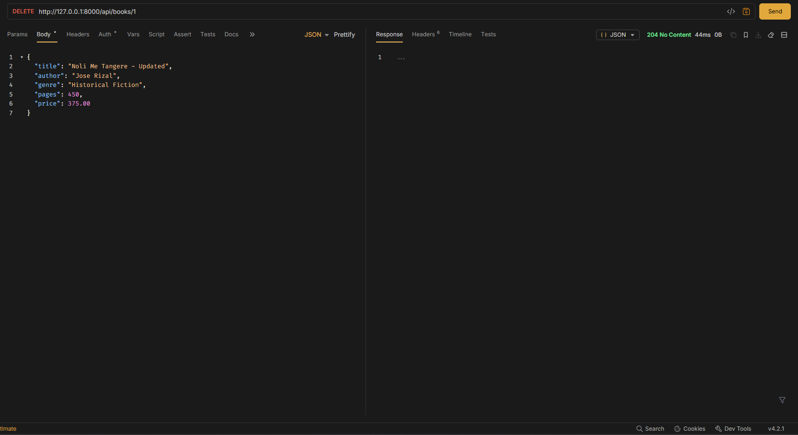

# Book API

**Partners:** ALEC RUPERT MENDOZA - JULLIANE RENEE GALANO
**Section:** IT3E
**Resource:** Book

## 1. Project Description

The Book API is a REST API developed using Laravel, SQLite, and Laravel Sanctum. It allows users to register, log in, and manage book records through authenticated requests. Each book contains a title, author, genre, number of pages, and price. The API also supports filtering books by their fields.

## 2. Setup Instructions

### Requirements

- PHP
- Composer
- Laravel
- Bruno

### Installation

1. Install the dependencies:

   ```bash
   composer install
   ```

2. Create the environment file:

   ```bash
   copy .env.example .env
   ```

3. Generate the application key:

   ```bash
   php artisan key:generate
   ```

4. Configure SQLite in `.env`:

   ```dotenv
   DB_CONNECTION=sqlite
   ```

5. Create an empty `database/database.sqlite` file if it does not exist.

6. Install API routing and Sanctum if they are not already configured:

   ```bash
   php artisan install:api
   ```

7. Run the migrations:

   ```bash
   php artisan migrate
   ```

8. Start the Laravel server:

   ```bash
   php artisan serve
   ```

9. Open Bruno and use `http://127.0.0.1:8000` as the base URL.

10. Register a user, log in, and use the returned Bearer token for protected requests.

## 3. API Routes

| Method | Path | Description | Token Required |
|---|---|---|---|
| POST | `/api/register` | Register a new user | No |
| POST | `/api/login` | Authenticate a user and receive a token | No |
| POST | `/api/logout` | Revoke the current token | Yes |
| GET | `/api/me` | Get the authenticated user's information | Yes |
| GET | `/api/books` | List and filter books | Yes |
| POST | `/api/books` | Create a book | Yes |
| GET | `/api/books/{book}` | Get a specific book | Yes |
| PUT | `/api/books/{book}` | Update a book | Yes |
| DELETE | `/api/books/{book}` | Delete a book | Yes |

### Book Fields

| Field | Type | Example |
|---|---|---|
| `title` | String | Noli Me Tangere |
| `author` | String | Jose Rizal |
| `genre` | String | Fiction |
| `pages` | Integer | 400 |
| `price` | Decimal | 350.00 |

### Filtering Examples

- `GET /api/books?genre=Fiction`
- `GET /api/books?author=Jose%20Rizal`
- `GET /api/books?genre=Fiction&author=Jose%20Rizal`
- `GET /api/books?pages=400`
- `GET /api/books?price=350`

## 4. API Test Screenshots

### Test 1 — Register a User (201)



### Test 2 — Login (200)



### Test 3 — Get Books Without a Token (401)



### Test 4 — Get Books With a Token (200)



### Test 5 — Create a Book (201)



### Test 6 — Missing Required Field (422)



### Test 7 — Get a Book by ID (200)


### Test 8 — Get a Nonexistent Book (404)



### Test 9 — Update a Book (200)



### Test 10 — Delete a Book (204)



## 5. Why Does DELETE Return 204 Instead of 200?


Answer: The reason why DELETE returned 204 instead of 200 is because, even though it returned a successful process, the system returned a blank page. Since the user (Us) deleted the records, the database has nothing to return, thus the 204. 
